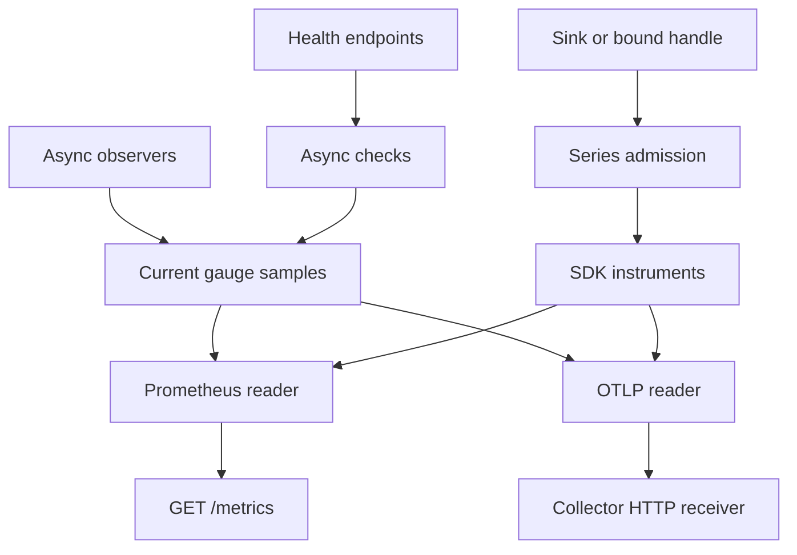

# Architecture

## defuss instrumentation contract

The `TelemetrySink` and `Attributes` types come from [defuss-open-telemetry 0.1.2](https://github.com/kyr0/defuss/blob/4ddb290567db95aa97eb1594d99f7b2afa6c2b8a/packages/open-telemetry/src/index.ts) and now live in `src/metrics.ts` and `src/series.ts`. The package has no dependency on it, and its published declarations import nothing from it. TypeScript compares interfaces by shape, so defuss code typed against that package's sink accepts `obs.sink`.

That package's sink bridge stores one gauge value and one attribute set per metric name, so updating a second labeled queue replaces the first. This library does not reuse the bridge. It creates all three instruments on its SDK meter. A shared registry applies the same label schema and series budget to dynamic writes and fixed-label handles. The synchronous gauge keeps a value for each admitted series.

A per-instrument map retains admitted label sets for the instance lifetime. Fixing admission across collections bounds cumulative growth when each interval sees new labels. Each excess sample goes directly to the SDK with its overflow attribute. Both readers have room for all admitted series, the explicit overflow series and the SDK's reserved slot. The SDK aggregates counters and histograms. An async observer has a per-snapshot point limit because it can withdraw earlier series. Both paths validate label types before exposing samples.

## Data flow

Each instance owns a meter provider and readers. Importing the package registers no global provider. Creating an instance opens no listener. A distinct resource instance ID defaults to a random UUID. Pass `instanceId` to supply an operator-managed identity. The application owns its server and process signals.

Callback results feed a shared MetricProducer. The SDK's cumulative observable gauge can retain a previous series when the callback emits nothing. Building the gauge points from each snapshot lets vanished or failed sources disappear immediately from both readers. The SDK owns counter and histogram aggregation, resource serialization and the exporter protocol. The additional producer supplies only measurement data. The SDK's Prometheus serializer handles escaping, type metadata and histograms.

## Series identity and push results

The label schema keys its type and spelling checks by the projected Prometheus name while retaining original OpenTelemetry keys in point data. New keys commit only after a whole write or observer snapshot validates. Omitting empty-string values before admission gives Prometheus and OTLP one identity for absent dimensions. Histogram declarations feed the same explicit boundary advice to the meter used by both readers.

The SDK periodic reader can complete a forced flush after an HTTP rejection. The push reader instead associates the collector acknowledgement and deadline with each scheduled collection. It permits one active export and one pending batch. The SDK still selects aggregation and temporality, serializes the request and handles endpoint resolution, headers and HTTP retries. An instance-local response decoder checks rejected point counts before completing that batch. Expiring an active request aborts its dedicated agent's sockets. A late response cannot deliver a second outcome. Hook exceptions stay outside the serving and export paths.

## Failure boundaries

Dependent services belong in readiness. A remote database outage then removes the instance from traffic while the liveness probe continues to succeed. An explicit liveness failure also fails readiness. Metrics export is independent of the serving decision. A failing observer exports its success flag alongside the remaining valid metrics. A failing Collector leaves the service's health decision to its registered checks.

Check and observer callbacks each have a single in-flight slot and cooperative cancellation. Timeout resolves the waiting requests. The slot remains occupied until the underlying promise settles. The optional successful-check cache uses a monotonic deadline from completion. Aborted work cannot fill the cache. Each registration owns its deadline. Draining overrides a cached result and skips readiness callbacks. Public metrics calls share a scrape while it is in flight. Built-in RSS is process memory. Host or container metrics require their own source.

A service publishes its state on its existing listener. Read access to the health and metrics routes follows the host application's routing and access controls. Probe bodies carry check names and bounded reason codes, never exception text. Metric labels carry only values the application passes, so the application decides which identifiers a scrape or push reveals. The Collector runs as a separate process and owns the OTLP receiver, including validation and protocol responses. The example binds its receiver to loopback. Use Collector exporter configuration to select a storage backend.

## Protocol and project references

- [OTLP/HTTP metrics request and response](https://opentelemetry.io/docs/specs/otlp/#otlphttp-request)
- [Prometheus series identity](https://prometheus.io/docs/concepts/data_model/)
- [OpenTelemetry HTTP duration conventions](https://opentelemetry.io/docs/specs/semconv/http/http-metrics/)
- [Prometheus exposition format](https://prometheus.io/docs/instrumenting/exposition_formats/)
- [Kubernetes container probes](https://kubernetes.io/docs/concepts/workloads/pods/probes/)
